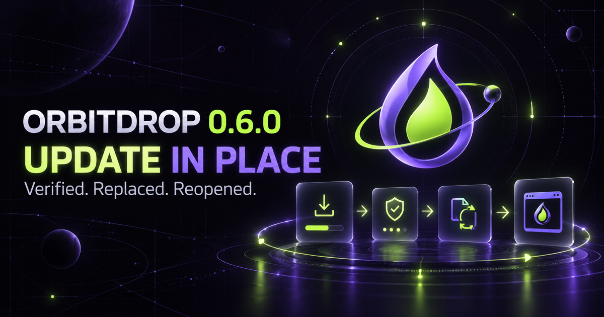

<div align="center">
  

  # OrbitDrop website

  **The privacy-first download, documentation, and release-verification website for OrbitDrop.**

  [**Visit orbitdropapp.vercel.app**](https://orbitdropapp.vercel.app) · [Download the desktop app](https://orbitdropapp.vercel.app/#download) · [Desktop source](https://github.com/sasukefrontenddev/orbitdrop)

  [](https://github.com/sasukefrontenddev/orbitdrop-website/actions/workflows/ci.yml)
  [](https://github.com/sasukefrontenddev/orbitdrop-website/actions/workflows/production-smoke.yml)
  [](https://nextjs.org/)
  [](https://react.dev/)
  [](https://orbitdropapp.vercel.app/privacy)
</div>



## A download site that does not handle your files

[OrbitDrop](https://github.com/sasukefrontenddev/orbitdrop) is a native macOS and Windows file converter, compressor, archive tool, and image editor. This repository contains its public product website—not a web converter.

Visitors can discover the product, choose the correct operating-system build, verify its checksum, read installation help, and review the privacy and security model. Actual file conversion and editing happen locally inside the desktop app.

## What this website provides

- A commercial, responsive product landing page
- Platform-aware macOS and Windows download choices
- Live release version, file-size, and SHA-256 metadata from GitHub Releases
- A readable checksum directory and step-by-step verification guide
- Installation help and system requirements
- Product features, release notes, and update guidance
- Plain-language privacy, security, and terms pages
- Accessible dark-mode UI and responsive navigation
- Release-specific Open Graph and social-sharing artwork

## Privacy by design

The website deliberately has:

- **no analytics or advertising scripts**;
- **no accounts or user database**;
- **no cookies or behavioral profiles**;
- **no file upload or conversion API**;
- **no local or session storage**; and
- **no telemetry endpoint**.

Platform detection runs only in browser memory. Download links point directly to official GitHub release assets. The website briefly caches public release metadata so it can show the current version and checksums without storing visitor information.

Automated tests scan the application source for tracking, storage, uploads, and write requests. See the live [privacy notice](https://orbitdropapp.vercel.app/privacy) and [security page](https://orbitdropapp.vercel.app/security).

## Pages

| Route | Purpose |
| --- | --- |
| [`/`](https://orbitdropapp.vercel.app) | Product overview, features, FAQ, and OS-aware downloads |
| [`/help`](https://orbitdropapp.vercel.app/help) | Installation, hotkey workflow, updates, and troubleshooting |
| [`/releases`](https://orbitdropapp.vercel.app/releases) | Version-by-version release history |
| [`/checksums`](https://orbitdropapp.vercel.app/checksums) | Current official SHA-256 values |
| [`/verify`](https://orbitdropapp.vercel.app/verify) | Checksum verification on macOS and Windows |
| [`/requirements`](https://orbitdropapp.vercel.app/requirements) | Supported operating systems and hardware |
| [`/privacy`](https://orbitdropapp.vercel.app/privacy) | Plain-language data-handling promise |
| [`/security`](https://orbitdropapp.vercel.app/security) | Release integrity and safe-use guidance |
| [`/terms`](https://orbitdropapp.vercel.app/terms) | Terms for the website and desktop software |

## Technology

- Next.js 16, React 19, and TypeScript
- vinext and Vite for Cloudflare Workers-compatible output
- Vercel production hosting at the official short URL
- OpenAI Sites deployment metadata for the maintained mirror
- GitHub Actions for linting, privacy tests, rendering tests, builds, dependency review, and production smoke tests

## Run locally

Requirements: Node.js 22.13 or later.

```bash
git clone https://github.com/sasukefrontenddev/orbitdrop-website.git
cd orbitdrop-website
npm install
npm run dev
```

The development server prints the local URL when it is ready.

## Validate a change

```bash
npm run lint
npm test
npm run build:vercel
```

`npm test` builds the Sites version, renders every public support route, checks the official download and checksum content, and verifies the absence of tracking and persistence code. The independent Vercel build catches platform-specific deployment problems before merge.

## Continuous delivery

Every pull request and change to `main` runs the full website validation suite. Vercel deploys accepted `main` updates automatically, and a production smoke test confirms the public routes and current release downloads.

The website reads the newest desktop version, asset names, download links, file sizes, and SHA-256 checksums from [OrbitDrop GitHub Releases](https://github.com/sasukefrontenddev/orbitdrop/releases). When the native release pipeline publishes a version, the website can serve it without committing a second installer copy to this repository.

## Contributing and security

- Read [CONTRIBUTING.md](CONTRIBUTING.md) before proposing a change.
- Keep every product claim aligned with the latest native release.
- Do not add analytics, cookies, tracking pixels, accounts, uploads, or user databases.
- Report ordinary website bugs through [GitHub Issues](https://github.com/sasukefrontenddev/orbitdrop-website/issues).
- Follow [SECURITY.md](SECURITY.md) for sensitive vulnerability reports.

## Related repository

The native Swift/AppKit and C#/.NET desktop apps, build pipeline, release checksums, and downloadable installers live in the main [**OrbitDrop repository**](https://github.com/sasukefrontenddev/orbitdrop).

## License

This repository is source-available for inspection, security review, education, and portfolio evaluation. It is **not open source**. Copying, modification, redistribution, sublicensing, sale, and derivative works require prior written permission. See [LICENSE](LICENSE).

<div align="center">
  <strong>A privacy-first website for a privacy-first desktop tool.</strong><br />
  <sub>No uploads · No tracking · No cookies · No account</sub>
</div>
