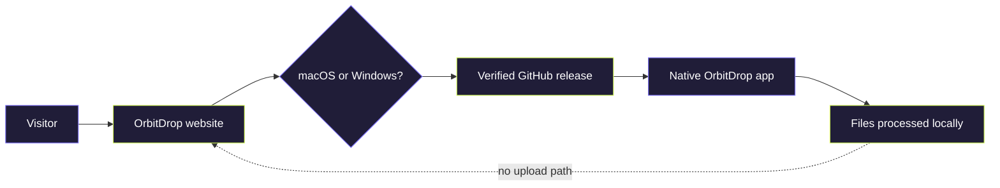
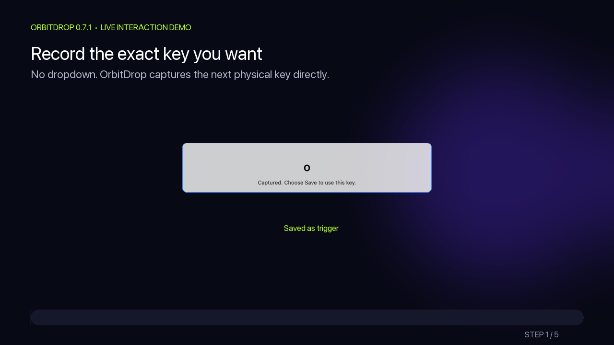
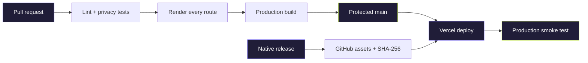

<div align="center">
  

  <br />

  

  # The OrbitDrop launch site

  ### A privacy-first front door for a privacy-first desktop tool.

  It detects the visitor's platform, presents the verified native build, and explains every permission.
  <br />
  Then it gets out of the way. **It never receives a user's files.**

  [](https://orbitdropapp.vercel.app)
  [](https://orbitdropapp.vercel.app/#download)

  [](https://github.com/sasukefrontenddev/orbitdrop-website/actions/workflows/ci.yml)
  [](https://github.com/sasukefrontenddev/orbitdrop-website/actions/workflows/production-smoke.yml)
  [](https://nextjs.org/)
  [](https://react.dev/)
  [](https://orbitdropapp.vercel.app/privacy)
</div>

---

## This is the launchpad—not the converter

[OrbitDrop](https://github.com/sasukefrontenddev/orbitdrop) is a native macOS and Windows file converter, compressor, archive tool, and image editor. This repository contains the cinematic product site, documentation hub, download router, and integrity layer around it.



The site reads public release metadata. The download buttons point to official GitHub release assets. The desktop app does the actual work—on the user's computer.

## A product website with a pulse

<div align="center">
  
  <br />
  <sub>The product interaction shown honestly: on the desktop, over the selected file.</sub>
</div>

| ✦ Discover | ✦ Download | ✦ Verify | ✦ Understand |
| :--- | :--- | :--- | :--- |
| Commercial product story | Platform-aware choices | Live SHA-256 values | Permission explanations |
| Responsive dark interface | Current version + size | Copyable terminal commands | Real workflow demo |
| Accessible FAQ system | Official release assets | Release provenance | Troubleshooting paths |

## The zero-data architecture

The website deliberately has:

| `0` | `0` | `0` | `0` | `0` | `0` |
| :---: | :---: | :---: | :---: | :---: | :---: |
| analytics | ads | accounts | cookies | uploads | telemetry |

- No user database, behavioral profile, tracking pixel, or advertising script
- No local storage, session storage, or hidden persistence layer
- No file upload field, conversion endpoint, or write API
- Platform detection exists only in browser memory
- Public release metadata is briefly cached to make the site fast—not to identify visitors

Automated tests scan the source for tracking, browser storage, uploads, and unexpected write requests. Read the live [privacy notice](https://orbitdropapp.vercel.app/privacy) and [security model](https://orbitdropapp.vercel.app/security).

## Nine pages. One coherent promise.

| Route | The job it performs |
| --- | --- |
| [**`/`**](https://orbitdropapp.vercel.app) | Product story, feature constellation, FAQ, and OS-aware download |
| [**`/help`**](https://orbitdropapp.vercel.app/help) | Installation, trigger-key workflow, updates, and troubleshooting |
| [**`/releases`**](https://orbitdropapp.vercel.app/releases) | Human-readable version history |
| [**`/checksums`**](https://orbitdropapp.vercel.app/checksums) | Current official SHA-256 values |
| [**`/verify`**](https://orbitdropapp.vercel.app/verify) | Exact verification commands for macOS and Windows |
| [**`/requirements`**](https://orbitdropapp.vercel.app/requirements) | Supported systems, processors, and dependencies |
| [**`/privacy`**](https://orbitdropapp.vercel.app/privacy) | Plain-language data-handling promise |
| [**`/security`**](https://orbitdropapp.vercel.app/security) | Release integrity, provenance, and safe-use guidance |
| [**`/terms`**](https://orbitdropapp.vercel.app/terms) | Terms for the website and desktop software |

## The stack behind the glass

```text
Next.js 16 + React 19 + TypeScript
             │
             ├── Vercel production build
             ├── vinext / Vite Sites build
             ├── GitHub Releases metadata
             └── GitHub Actions validation + production smoke test
```

The repository maintains both the official Vercel deployment and the Sites-compatible build without introducing a second download source. Release information always resolves back to the native app's GitHub Releases.

## Run the launchpad locally

Requirements: Node.js 22.13 or later.

```bash
git clone https://github.com/sasukefrontenddev/orbitdrop-website.git
cd orbitdrop-website
npm install
npm run dev
```

The development server prints the local address when it is ready.

## Try to break it before a visitor can

```bash
npm run lint
npm test
npm run build:vercel
```

The test suite builds the Sites version, renders every public support route, checks the official download and checksum content, and verifies the absence of tracking and persistence code. The independent Vercel build catches production-specific failures before merge.

## Continuous delivery, with a checksum at every handoff



Every pull request and change to `main` runs the complete validation suite. Vercel deploys accepted changes automatically, then a production smoke test confirms the live routes and current release download.

When the native pipeline publishes a version, the site reads its asset names, URLs, sizes, and SHA-256 checksums automatically. There is no installer copy in this repository to become stale.

## Guardrails for contributors

- Read [CONTRIBUTING.md](CONTRIBUTING.md) before proposing a change.
- Keep every product claim aligned with the latest [native release](https://github.com/sasukefrontenddev/orbitdrop/releases/latest).
- Do not add analytics, cookies, tracking pixels, accounts, uploads, or user databases.
- Report ordinary bugs through [GitHub Issues](https://github.com/sasukefrontenddev/orbitdrop-website/issues).
- Use [SECURITY.md](SECURITY.md) for sensitive vulnerability reports.

## Two repositories. One product.

| Repository | Responsibility |
| --- | --- |
| [**`orbitdrop`**](https://github.com/sasukefrontenddev/orbitdrop) | Native Swift/AppKit and C#/.NET apps, file engines, updater, platform builds, release artifacts |
| [**`orbitdrop-website`**](https://github.com/sasukefrontenddev/orbitdrop-website) | Product experience, documentation, release discovery, checksums, download routing |

## License

This repository is source-available for inspection, security review, education, and portfolio evaluation. It is **not open source**. Copying, modification, redistribution, sublicensing, sale, and derivative works require prior written permission. See [LICENSE](LICENSE).

---

<div align="center">
  <strong>A website that earns trust by asking for nothing.</strong>
  <br />
  <sub>No uploads · No tracking · No cookies · No account</sub>
  <br /><br />
  <a href="https://orbitdropapp.vercel.app">Enter OrbitDrop</a>
  &nbsp;·&nbsp;
  <a href="https://github.com/sasukefrontenddev/orbitdrop/stargazers">Star the native app</a>
</div>
